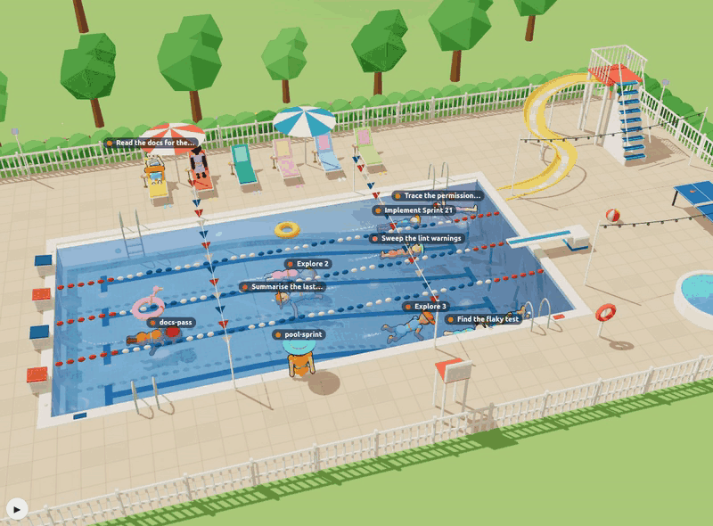
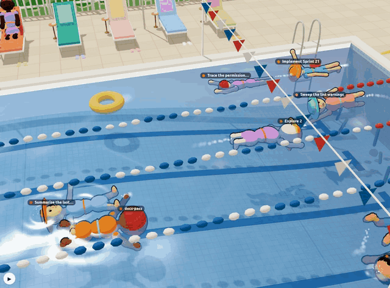
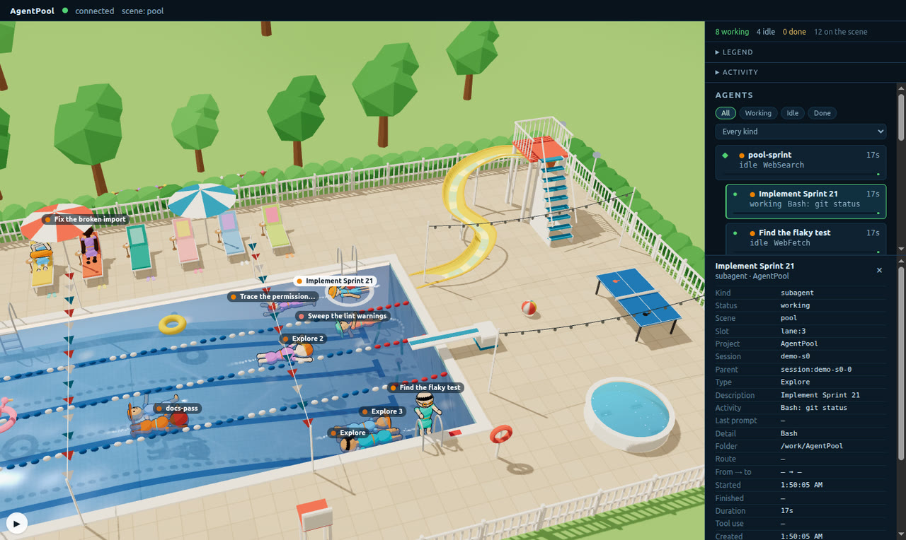
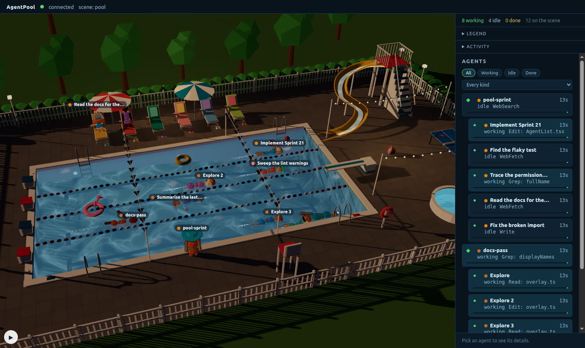
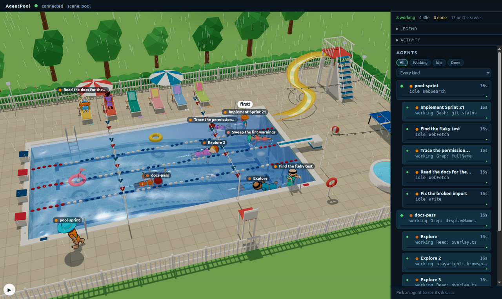

<div align="center">

# 🏊 AgentPool

**Watch your Claude Code agents swim.**

A live 3D dashboard for [Claude Code](https://docs.claude.com/en/docs/claude-code/overview).
Every session and every subagent becomes a little character in a swimming pool.
Working agents swim. Idle agents relax on a sun-lounger with a cup of tea.

[](https://github.com/SahinErtan/AgentPool/actions/workflows/ci.yml)
[](LICENSE)




[Quick start](#-quick-start) ·
[Try the demo](#-try-it-without-claude-code) ·
[Configuration](#%EF%B8%8F-configuration) ·
[How it works](#-how-it-works) ·
[Video tour](docs/media/tour.mp4)

</div>

---

## ✨ What is this?

When you run many Claude Code sessions and subagents at once, it is hard to
know who is busy, who is waiting for you and who is done. AgentPool shows
all of them in one picture, and the picture changes the moment an agent
starts or stops working.

| When the agent is… | the character… |
|---|---|
| 🏊 **working** | jumps into the pool and swims |
| ☕ **idle** | lies on a sun-lounger with tea, a book or a newspaper |
| ✋ **waiting for you** | puts a hand up |
| ✅ **finished** | climbs out of the pool, and the others wave |
| 🚪 **closed** | walks out through the gate |

**The swimming stroke tells you the tool.** An agent running a shell command
sprints, an agent editing a file swims butterfly, an agent reading or
searching wears a snorkel and dives, and an agent on the web does
backstroke.

A few more things you get:

- 🎨 **Every character is unique** and always looks the same for the same
  agent. There are no image files in this project: the characters, the pool
  and the deck are all drawn by code.
- 🌤️ **The pool follows the clock.** Sunlight in the day, lamps at night,
  and sometimes it rains.
- 🔍 **Click any character** (or a row in the list) to see its folder, its
  prompt, its current tool and how long it has been running.
- 🔒 **Everything stays on your computer.** The backend listens on
  `127.0.0.1` only. Nothing is sent to the internet.

<table>
  <tr>
    <td></td>
    <td></td>
  </tr>
  <tr>
    <td align="center"><sub>Each tool has its own swimming stroke</sub></td>
    <td align="center"><sub>Click an agent to see its details</sub></td>
  </tr>
  <tr>
    <td></td>
    <td></td>
  </tr>
  <tr>
    <td align="center"><sub>At night the lamps come on</sub></td>
    <td align="center"><sub>Sometimes it rains</sub></td>
  </tr>
</table>

🎬 **Video tour:** [docs/media/tour.mp4](docs/media/tour.mp4) (about 30 seconds).

---

## 🚀 Quick start

### 1. Check the requirements

| You need | Why |
|---|---|
| **Linux or macOS** | The plugin hooks are small bash scripts. (Windows is not tested; WSL may work.) |
| **Python 3.11** | Runs the backend. `make install` needs a `python3.11` command, or [pyenv](https://github.com/pyenv/pyenv) with 3.11.11. |
| **Node.js 20 or newer** | Builds the web page. |
| **`make`, `curl`, `bash`** | Used by the install steps and the hooks. |
| **[Claude Code](https://docs.claude.com/en/docs/claude-code/overview)** | The `claude` command. Only needed for the plugin step. |
| **A browser with WebGL2** | Any current Chrome, Firefox, Safari or Edge. |

### 2. Install

```sh
git clone https://github.com/SahinErtan/AgentPool.git
cd AgentPool
make install
```

`make install` does three things:

1. creates a Python environment (pyenv if you have it, otherwise a `venv/`
   folder inside the project),
2. installs the backend and frontend dependencies,
3. builds the web page into `frontend/dist`.

It does **not** change anything outside the project folder.

### 3. Connect it to Claude Code

```sh
make plugin
```

This installs the AgentPool plugin into Claude Code. It is a separate step
because it changes your global Claude Code settings. After this:

- every time a Claude Code session starts, the plugin starts the AgentPool
  backend (if it is not already running), and
- every hook event (prompt, tool use, subagent start and stop, …) is sent to
  the backend on your own computer.

> **Keep the project folder where it is.** `make plugin` remembers its path
> in `~/.config/agentpool/root`, so the plugin can start the backend from
> there. If you move the folder, run `make plugin` again.

### 4. Open the pool

Start any Claude Code session, then open:

**👉 <http://127.0.0.1:38000>**

Your session appears as a character. Give it a task and watch it jump into
the water. When it starts a subagent, a new character walks in through the
gate.

> You can also start the backend yourself with `make server`, for example
> before you start Claude Code. Stop it with `make server-stop`.

---

## 🎮 Try it without Claude Code

You do not need Claude Code to look around. The demo mode plays twelve
scripted agents in the browser:

```sh
make install
make server
```

Then open <http://127.0.0.1:38000/?demo=12>.

---

## 🧭 Using it

### The dashboard

- **The pool** (left) shows every agent. Drag to turn the camera, scroll to
  zoom. Click a character to select it.
- **The list** (right) shows the same agents as text, with a filter
  (*Working*, *Idle*, *Done*, and by kind). The small bar under each row shows
  when that agent was busy in the last 15 minutes.
- **The inspector** opens when you select an agent: its folder, its prompt,
  its current tool, its parent session and its timing.
- **Activity** shows the latest events and the health of the backend.
- **Legend** explains the marks, the strokes and the keys.

**Keys:** ↑ / ↓ move through the list · Enter opens the inspector · Esc
closes it · **T** starts a camera tour · **F** follows the selected agent.

### Useful addresses

| Address | What it shows |
|---|---|
| `/` | The pool with your real agents |
| `/?demo=12` | Twelve fake agents, no backend data needed |
| `/?demo=60&debug` | A crowd of 60, with fps and render stats in the corner |
| `/?lab` | The animation lab: every swim style and every idle activity |
| `/?agent=<id>` | Opens with that agent already selected |

### From the terminal

Ask the running pool what your agents are doing:

```sh
make agentpool                         # a short table
make agentpool ARGS="--watch"          # keeps updating
make agentpool ARGS="--json"           # for scripts
make agentpool ARGS="--agent <id>"     # one agent in detail
```

Exit codes: `0` the pool answered · `1` the backend is not running · `3`
the agent you asked for is not there.

### From inside Claude Code

Type **`/agentpool`** in a session. Claude reads the pool and tells you who
is working, what they are doing and if anything looks stuck.

---

## ⚙️ Configuration

AgentPool works without any configuration. If you want to change something,
set one of these environment variables.

| Variable | Default | What it changes |
|---|---|---|
| `AGENTPOOL_PORT` | `38000` | The port of the backend. See the note below. |
| `AGENTPOOL_HOST` | `127.0.0.1` | The address the backend listens on. |
| `AGENTPOOL_TOKEN` | *(empty)* | A password for the dashboard and the API. See [Security](#-privacy-and-security). |
| `AGENTPOOL_IDLE_TTL_S` | `90` | Seconds an idle agent stays in the pool. |
| `AGENTPOOL_SESSION_TTL_S` | `900` | Seconds a silent session stays before it is removed. |
| `AGENTPOOL_EXIT_GRACE_S` | `15` | Seconds a closing agent gets to walk out of the gate. |
| `AGENTPOOL_NOTIFY` | `1` | Desktop notification when an agent that worked for 30 s or more finishes. `0` turns it off. |
| `AGENTPOOL_JOURNAL` | `1` | Write every event to the journal on disk. `0` turns it off. |
| `AGENTPOOL_JOURNAL_KEEP_DAYS` | `7` | Days the journal is kept. |
| `AGENTPOOL_JOURNAL_REPLAY_WINDOW_S` | `900` | At start, events from this many seconds back are put back into the pool. |
| `AGENTPOOL_CLAUDE_DIR` | `~/.claude` | Where Claude Code keeps its session files. |
| `AGENTPOOL_STATE_DIR` | `~/.local/state/agentpool` | Where the journal, the log and the pid file go. |
| `AGENTPOOL_ROOT` | *(from `make plugin`)* | The project folder the plugin starts the backend from. |
| `AGENTPOOL_PYTHON` | *(auto)* | The Python the plugin uses to start the backend. |

**How to set them**

- If you start the backend yourself, set them in the same terminal:

  ```sh
  AGENTPOOL_NOTIFY=0 AGENTPOOL_IDLE_TTL_S=300 make server
  ```

- If the plugin starts the backend, it uses the environment of your Claude
  Code session. Put the variables in your shell profile (`~/.bashrc`,
  `~/.zshrc`), or in the `env` block of `~/.claude/settings.json`:

  ```json
  {
    "env": {
      "AGENTPOOL_NOTIFY": "0"
    }
  }
  ```

  The backend reads the variables only when it starts, so restart it after a
  change: `make server-stop`, then open a new Claude Code session (or run
  `make server`).

> **About the port:** the plugin's hooks send their events to
> `http://127.0.0.1:38000`, and this address is fixed in
> `plugin/agentpool/hooks/hooks.json`. If you change `AGENTPOOL_PORT`, change
> the port in that file too, then run `make plugin` again.

---

## 🔒 Privacy and security

- The backend listens on **`127.0.0.1` only**, so other computers cannot
  reach it. Nothing is sent to the internet.
- Requests from web pages on other sites are refused, so a random page in
  your browser cannot add fake agents to the pool.
- The journal (`~/.local/state/agentpool/events/`) keeps the hook events for
  7 days. **These include your prompts and the folders you work in.** Turn it
  off with `AGENTPOOL_JOURNAL=0`, or delete the folder at any time.
- Want a password? Set `AGENTPOOL_TOKEN=some-secret`. Then open the dashboard
  as `http://127.0.0.1:38000/?token=some-secret`. The `make agentpool` command
  reads the same variable. (The `/agentpool` slash command does not send a
  token.)
- If you set `AGENTPOOL_HOST` to something other than `127.0.0.1`, the
  dashboard can be seen from your network. Always set a token in that case.

---

## 🛠️ Troubleshooting

| Problem | What to try |
|---|---|
| The page does not open | Is the backend running? `curl http://127.0.0.1:38000/api/health`. If not, run `make server` and read the error. |
| The pool is empty | Check the plugin is installed: `claude plugin list` should show `agentpool`. Then start a **new** Claude Code session. |
| The backend does not start by itself | Read the log: `~/.local/state/agentpool/server.log`. Run `make plugin` again if you moved the project folder. |
| "AgentPool is already running" | The plugin already started it. Just open the page, or stop it with `make server-stop`. |
| The page says `{"detail":"Not Found"}` | The web page is not built yet. Run `make build` (or `make install`), then restart the backend. |
| A black or empty scene | Your browser needs WebGL2. Check `chrome://gpu` or try another browser. |

---

## 🗑️ Uninstall

```sh
make server-stop
make plugin-uninstall
rm -rf ~/.config/agentpool ~/.local/state/agentpool
```

Then delete the project folder.

---

## 🧠 How it works

```
Claude Code ──hook──▶ bridge ──▶ registry ──▶ scene ──▶ WebSocket ──▶ browser (Three.js)
```

1. **The plugin** registers Claude Code hooks. Each hook posts its event as
   JSON to the backend.
2. **The bridge** (`backend/agentpool/bridge/`) turns raw hook events into
   agent events. It knows about agents, never about pools.
3. **The registry** keeps the list of agents and their state. Every 30
   seconds it also checks `~/.claude` in case a hook was missed.
4. **The scene** (`backend/agentpool/scenes/`) decides where each agent
   belongs: a lane to swim in, a lounger to lie on. It lives on the server,
   so two browser tabs always show the same thing.
5. **The browser** draws the pool with Three.js (WebGL2). React only draws
   the side panels.

The bridge does not depend on the pool, so you can build a different scene
(an office, a stadium) on top of it. See [docs/scenes.md](docs/scenes.md) and
[docs/porting.md](docs/porting.md).

### The backend API

| Endpoint | Returns |
|---|---|
| `GET /api/health` | Is it alive, and for how long |
| `GET /api/state` | The whole pool: every agent, the counts and the scene |
| `GET /api/agents` | The agents, without the scene |
| `GET /api/agents/<id>` | One agent, with its last events |
| `GET /api/history` | The most recent events from the journal |
| `GET /api/metrics` | Counters: events received, refused, dropped, last error |
| `WS /ws` | Live updates for the dashboard |
| `POST /hooks/<Event>` | Where the plugin sends the Claude Code hook events |

---

## 👩‍💻 Development

```sh
make server      # backend on :38000
make frontend    # vite dev server on :5173 with hot reload (talks to the backend on :38000)
make test        # backend (pytest) and frontend (node --test) tests
make build       # type check and build the frontend
make release     # pack everything into dist/agentpool-<version>.tar.gz
```

The frontend tests are TypeScript and run in plain Node, with no browser and
no WebGL. All decisions (where an agent goes, what it does, when) live in
small pure modules that can be tested on their own; the Three.js code only
draws what they decided.

<details>
<summary><b>Debug hooks in the browser console</b></summary>

With `?debug` or `?demo` in the address, the page exposes a few helpers:

```js
const s = window.__agentpool;
s.stats();                               // { fps, calls, triangles, agents, props }
s.debug.list();                          // every character: id, state, position, action, ...
s.debug.play(id, 'cheer');               // play an action once
s.debug.force(id, { work: 'edit' });     // pretend the agent uses this kind of tool; null clears
s.debug.force(id, { errand: 'towel' });  // start an errand now
s.debug.force('weather', 'rain');        // 'clear' | 'cloudy' | 'rain'
s.debug.clock(14);                       // show the pool at this hour; null for the real clock
s.debug.creature('duck');                // 'duck' | 'birds'
s.debug.look(x, z, 8);                   // point the camera at a spot
```

</details>

### Repository layout

```
backend/agentpool/   the backend: bridge, registry, scene, API, CLI
frontend/src/        the web page: the 3D scene, the characters, the panels
plugin/              the Claude Code plugin: hooks and the /agentpool command
tests/               backend tests
frontend/test/       frontend tests
docs/                documentation and media
```

### More documentation

- [Architecture](docs/architecture.md) — the main seam, character identity, the pose model
- [Scenes](docs/scenes.md) — the scene contract, and how to write a new scene
- [Agent lifecycle](docs/lifecycle.md) — the states, the sweeper, the reconciler
- [Hook events](docs/hook-events.md) — what the plugin sends
- [Porting](docs/porting.md) — how to reuse the bridge in another project
- [Roadmap](docs/next.md) and [sprint plans](docs/plans/) — the development history and what comes next

---

## 🤝 Contributing

Issues and pull requests are welcome. Please run `make test` before you open
a pull request. The CI runs the same tests on every push.

## 📄 License

[MIT](LICENSE) © Sahin Ertan

<sub>AgentPool is a community project and is not affiliated with Anthropic.</sub>
