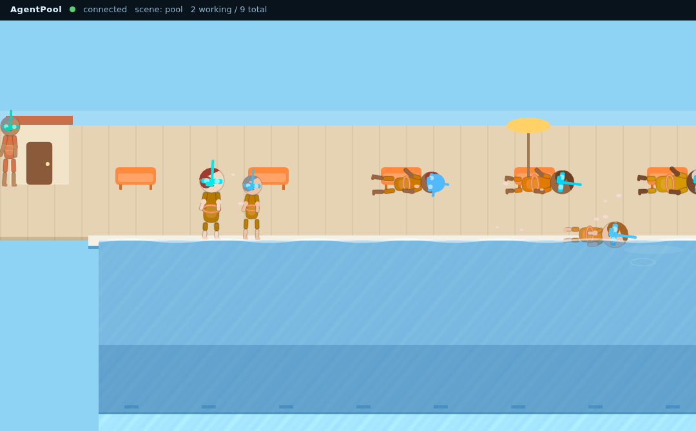

# AgentPool

Your Claude Code agents swim in a pool.

The usual way to watch an agent is to see it sit at a desk and type. AgentPool
does the opposite: an idle agent lies on a sun-lounger with a cup of tea, and
the moment it starts working it jumps into the pool and swims. When it is
done it climbs out and goes back to lounging. When the session ends it walks
out through the gate, and the next agent walks in through the same gate.

There are no picture assets. Every character is drawn from vectors at run
time, and every character is different.



## What it shows

- Every Claude Code session and every subagent, as a character.
- The state of each one: idle, working, done, on its way out.
- The details of an agent when you click it: the folder it works in, the
  prompt it got, how long it has been running.

## Install

```sh
make install     # the python environment and the frontend dependencies
make plugin      # register the Claude Code plugin
```

`make plugin` installs the plugin from the local marketplace in `plugin/`, so
it always matches the code in this working copy.

The dashboard comes up on <http://127.0.0.1:38000> as soon as a session
starts. The plugin starts the backend if it is not listening yet.

## Run it by hand

```sh
make server      # the backend on :38000, with the built frontend
make frontend    # the vite dev server on :5173, with hot reload
make test        # the backend test suite
make lab         # the animation lab: every swim style and every idle activity
```

The lab is at <http://127.0.0.1:5173/?lab>. It shows the four swim styles
(crawl, breaststroke, butterfly, doggy) and the idle activities (tea, book,
phone, sunbathe, nap, stretch, chat) next to each other, with a slider for
the phase and a dump of the pose weights.

## How it works

```
Claude Code ──hook──▶ the bridge ──▶ the registry ──▶ the scene ──▶ the browser
```

1. **The hook.** The plugin registers the Claude Code hooks. `SessionStart`
   starts the backend if it is not running yet; every other event is posted
   straight to the ingest endpoint over HTTP.
2. **The bridge** (`backend/agentpool/bridge/`) turns the raw hook payloads
   into events. It is deliberately dull: it knows about agents, never about
   scenes.
3. **The registry** owns the agents: who exists, what state they are in, when
   they are dropped.
4. **The scene** decides where an agent belongs: a lane to swim in, a lounger
   to lie on. The pool is one scene; `docs/scenes.md` explains how to write
   another one.
5. **The browser** draws the scene with PixiJS. The React layer only draws
   the panels; the 60 fps path never touches React.

The parts are documented in `docs/`:

- [the hook events](docs/hook-events.md)
- [the lifecycle of an agent](docs/lifecycle.md)
- [the scenes](docs/scenes.md)
- [the architecture](docs/architecture.md)
- [the sprint plan](docs/sprints.md)

## Configuration

| Variable | Default | What it does |
|---|---|---|
| `AGENTPOOL_PORT` | `38000` | The port the backend listens on. |
| `AGENTPOOL_SCENE` | `pool` | The scene: `pool` or `stadium`. |
| `AGENTPOOL_IDLE_TTL_S` | `90` | How long an idle agent is kept. |
| `AGENTPOOL_SESSION_TTL_S` | `900` | How long a silent session is kept. |
| `AGENTPOOL_EXIT_GRACE_S` | `30` | How long a closing agent may take to walk out. |
| `AGENTPOOL_CLAUDE_DIR` | `~/.claude` | Where the reconciler looks for sessions. |

The frontend has two query parameters: `?debug` shows the state of every
character, and `?lab` opens the animation lab instead of the pool.
